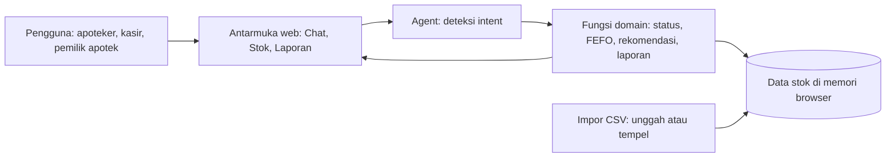
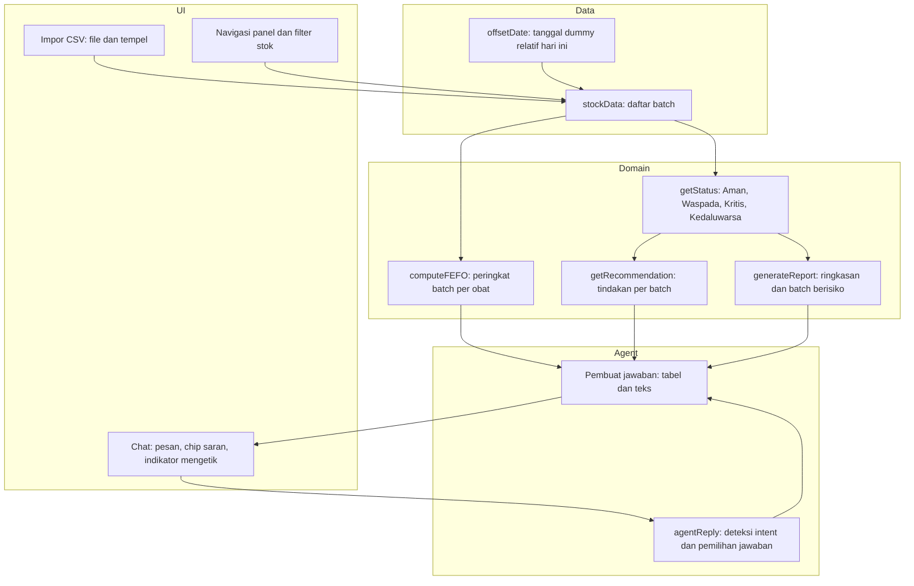
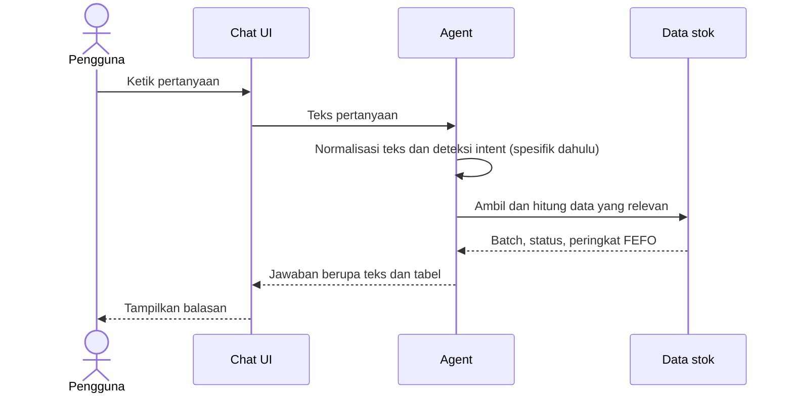
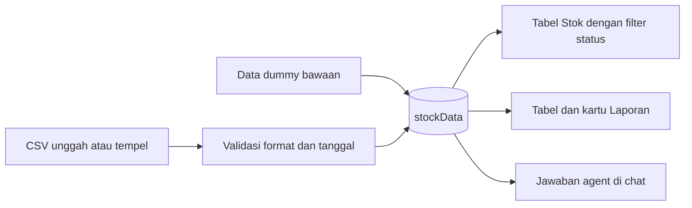

# Arsitektur PharmaStock Advisor

PharmaStock Advisor adalah aplikasi web satu halaman yang berjalan sepenuhnya di browser. Tidak ada backend, database server, maupun API key. Semua logika agent berada di `script.js`.

## 1. Gambaran Umum



Pengguna bertanya lewat chat. Agent menentukan maksud pertanyaan, memanggil fungsi yang sesuai, mengambil data dari stok, lalu merender jawaban berupa teks dan tabel.

## 2. Struktur File

| File | Peran |
|---|---|
| `index.html` | Kerangka halaman: header, navigasi tab, panel Chat, Stok, Laporan, dialog tempel CSV |
| `style.css` | Tampilan: warna, tata letak, badge status, tabel, gelembung chat |
| `script.js` | Data stok, logika status dan FEFO, rekomendasi, laporan, agent, antarmuka chat, impor CSV |

## 3. Komponen di `script.js`



## 4. Aturan Domain

**Status kedaluwarsa** dihitung dari selisih hari antara tanggal kedaluwarsa dan hari ini:

| Status | Kriteria |
|---|---|
| Kedaluwarsa | sisa hari kurang dari 0 |
| Kritis | sisa hari 0 sampai kurang dari 90 |
| Waspada | sisa hari 90 sampai kurang dari 180 |
| Aman | sisa hari 180 atau lebih |

**FEFO (First Expired, First Out):** batch dari obat yang sama diurutkan berdasarkan tanggal kedaluwarsa dari yang paling dekat. Batch dengan peringkat 1 harus dijual lebih dulu.

**Rekomendasi tindakan** mengikuti status:

| Status | Tindakan |
|---|---|
| Aman | Normal |
| Waspada | Pantau dan promosikan |
| Kritis | Diskon penjualan, atau retur bila sisa waktu sangat pendek |
| Kedaluwarsa | Hentikan penjualan, karantina, dan musnahkan sesuai prosedur |

## 5. Alur Pemrosesan Pertanyaan



Prinsip yang dipakai agent:
1. **Intent spesifik diperiksa lebih dulu** daripada intent umum, misalnya "hampir kedaluwarsa dalam N bulan" sebelum "sudah kedaluwarsa".
2. **Pencocokan kata utuh** agar kata pendek tidak salah cocok di dalam kata lain.
3. **Jawaban hanya dari data stok.** Jika pertanyaan tidak dipahami, agent menampilkan contoh pertanyaan yang dapat diajukan.

## 6. Intent yang Didukung

| Intent | Contoh pertanyaan |
|---|---|
| Sudah kedaluwarsa | "Obat apa yang sudah kedaluwarsa?" |
| Hampir kedaluwarsa | "Obat apa yang hampir kedaluwarsa dalam 3 bulan?" |
| Status Kritis, Waspada, Aman | "Tampilkan batch berstatus Kritis" |
| Urutan FEFO | "Batch mana yang dijual dulu untuk Amoxicillin?" |
| Rekomendasi tindakan | "Apa rekomendasi untuk batch Waspada?" |
| Nilai stok | "Berapa total nilai stok saya?" |
| Laporan harian | "Buat laporan harian" |
| Detail obat | "Tampilkan stok Paracetamol" |

## 7. Alur Data



Data disimpan di memori browser sehingga kembali ke data dummy saat halaman dimuat ulang, kecuali fitur penyimpanan ditambahkan di pengembangan berikutnya.

Format CSV yang diterima, dengan tanggal berformat `YYYY-MM-DD`:

```
nama,batch,kadaluarsa,qty,harga_beli,harga_jual
```

## 8. Keputusan Desain

| Keputusan | Alasan |
|---|---|
| HTML, CSS, dan JavaScript murni | Sesuai ketentuan panitia, tanpa instalasi, dan dapat dibuka langsung di browser |
| Tanpa backend dan tanpa API key | Mudah didemokan dan tidak ada risiko kebocoran kunci |
| Agent berbasis intent | Jawaban dapat diprediksi dan hanya bersumber dari data stok |
| Data dummy relatif terhadap hari ini | Keempat status selalu muncul saat demo |
| Ikon SVG inline | Konsisten di semua perangkat dan warnanya mengikuti status |

## 9. Keterbatasan dan Pengembangan Lanjutan

- Pemahaman pertanyaan berbasis aturan sehingga belum menangani kalimat yang sangat bebas atau salah ketik berat.
- Data belum tersimpan permanen.
- Belum terhubung ke sistem POS apotek.

Pengembangan lanjutan: integrasi model bahasa (LLM) lewat backend kecil, penyimpanan data, integrasi POS, notifikasi, dan prediksi restock.
